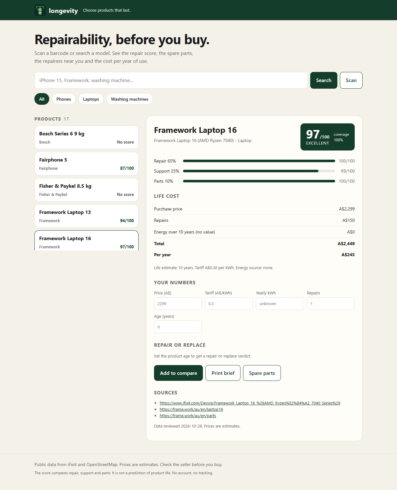
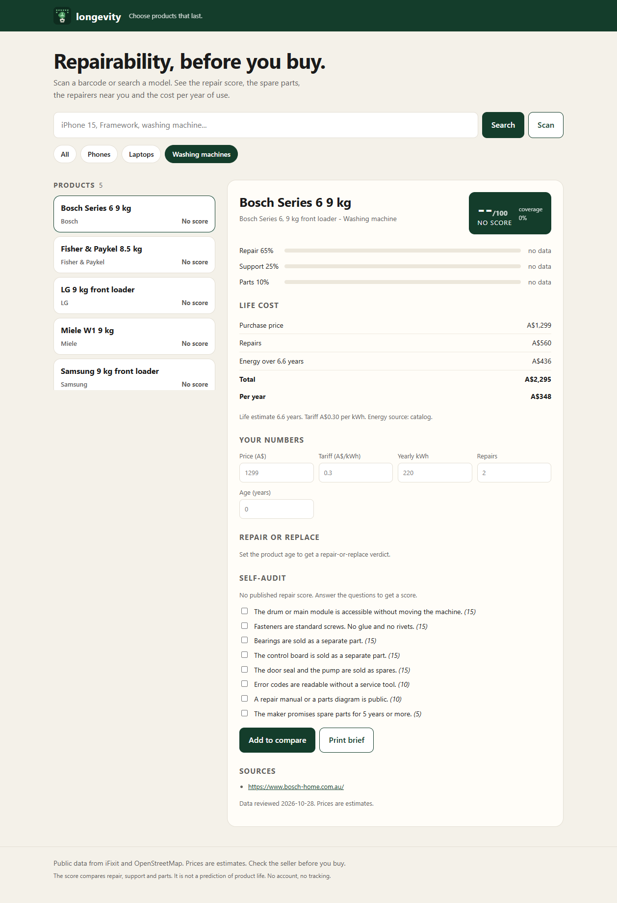

# longevity

A repairability scanner for household products. Scan a barcode or search a model.
See the repair score, spare parts, local repairers and the cost per year of use.

[](LICENSE)
[](#tests)
[](package.json)
[](package.json)

## Why

Repair scores, spare parts and repairers sit on different sites. Buyers cannot
compare them at the point of sale. The EU Digital Product Passport becomes
mandatory in 2027. Consumer tools are still missing.

`longevity` joins the public data in one place. It works offline. It stores no
personal data.

## Features

- **Longevity Score from 0 to 100.** Three parts: repair 65, support 25 and
  parts 10. A missing part is removed and the weights scale back. The score also
  reports coverage.
- **Life cost in AUD per year.** The estimate covers the price, the repairs and
  the energy. You can change the tariff, the repair count and the energy use.
- **Repair or replace verdict.** The tool compares repair cost per remaining
  year with replacement cost per year of use.
- **Eight-question self-audit.** Use it when a product has no published score.
  This is the main path for washing machines.
- **Barcode lookup.** EAN-8, UPC-A, EAN-13 and GTIN-14. The tool checks the
  check digit and rejects a bad code.
- **Local repairers.** The tool reads OpenStreetMap Overpass data with three
  mirrors and a disk cache.
- **Printable brief.** One page for a product, with the numbers and the sources.
- **Static PWA and CLI.** Both use the same score math. A test compares them on
  every catalog product.

## Quick start

```bash
git clone https://github.com/fuleinist/longevity.git
cd longevity
npm install

npm test                      # 124 tests
npx tsx src/index.ts demo     # no network needed
npx tsx src/index.ts search macbook
npx tsx src/index.ts show framework-13 --age 2
```

Build the web catalog and open the app:

```bash
npx tsx src/index.ts build       # writes web/catalog.json
npm run serve                    # http://127.0.0.1:8080/
```

Other commands:

```bash
longevity scan 8712412001231            # barcode lookup
longevity compare fairphone-5 pixel-8   # side-by-side rows
longevity repairers --lat -33.79 --lon 151.18 --radius 3000
longevity report pixel-8 --out reports/pixel-8.html --age 1
longevity audit                          # list the eight questions
longevity refresh --dry-run              # read iFixit, write nothing
```

Exit codes: `0` ok, `1` runtime error, `2` usage or bad input, `3` data error.

## Screenshots


*Product view. Framework Laptop 16 scores 97/100. The life cost is A$245 per year.*


*Self-audit view. The Bosch Series 6 has no published repair score, so the eight questions apply.*

## How the score works

| Part | Weight | Input |
| --- | --- | --- |
| Repair | 65 | iFixit score x 10, or the self-audit score |
| Support | 25 | Guide count and tool count, log scale |
| Parts | 10 | A spare-parts link is present |

A missing part is removed. The remaining weights scale back to 100. Coverage
reports the share of weight that had data.

The score compares repair, support and parts. It is not a prediction of product
life.

Life cost:

```
lifeYears = categoryBaseYears x (0.55 + 0.09 x repairScore10)
total     = price + repairEvents x repairCost + yearlyEnergyCost x lifeYears
perYear   = total / lifeYears
```

Category base years: phone 5, laptop 7, washer 12.

## Data sources

| Source | Use | Access |
| --- | --- | --- |
| [iFixit API v2.0](https://www.ifixit.com/api/2.0/doc) | Repair score, guide count, tool count | Public, no key |
| [OpenStreetMap Overpass](https://wiki.openstreetmap.org/wiki/Overpass_API) | Repair shops and repair cafes | Public, no key |
| [UPCitemdb trial](https://www.upcitemdb.com/api/explorer) | Optional barcode to title lookup | Public trial, 100 calls per day |
| Manufacturer pages | Spare-parts links | Public links, curated |

Every product entry lists its sources and the date of the data.

## Limits

- **EPREL is not used.** The public API returned HTTP 403 without a key in
  October 2026. The energy label data is therefore not in this release.
- **iFixit scores are missing for many models.** The tool shows "no published
  score" and offers the self-audit.
- **Washing machines rarely have a published score.** The self-audit is the main
  path for that category.
- **Barcode coverage is sparse.** A barcode miss is a normal result, not an
  error. The index ships with no barcodes, so the scanner shows the "not in the
  index" message until you add codes.
- **Prices are estimates.** Override the price on the command line or in the app.
- **Overpass servers can be busy.** The client tries three mirrors and then the
  cache. A stale cache beats an empty result.

## Project layout

```
src/        TypeScript: catalog, score, life cost, decision, search, barcode,
            overpass, report, refresh, CLI
web/        Static PWA: index.html, app.js, score.js, styles.css, sw.js
data/       Curated catalog with sources
scripts/    Seed, serve
test/       Node test runner suites, including CLI to PWA parity
```

## Development

```bash
npm run build      # tsc, strict mode
npm test           # node test runner through tsx
npm run typecheck
```

Zero runtime dependencies. Development tools only.

### Tests

124 tests cover the score, life cost, verdict, barcode checksum, search,
catalog validation, Overpass parsing, cache fallback, report escaping, refresh
paths and the CLI. Five parity tests compare the CLI math with the web app math
on every catalog product.

## License

MIT. See [LICENSE](LICENSE).